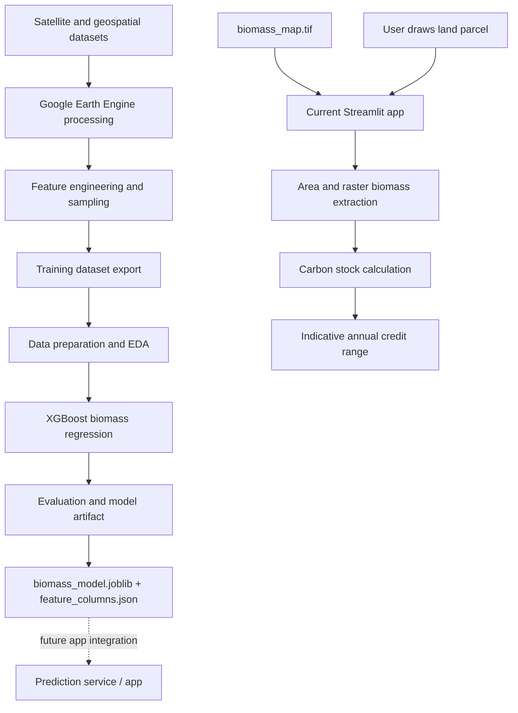
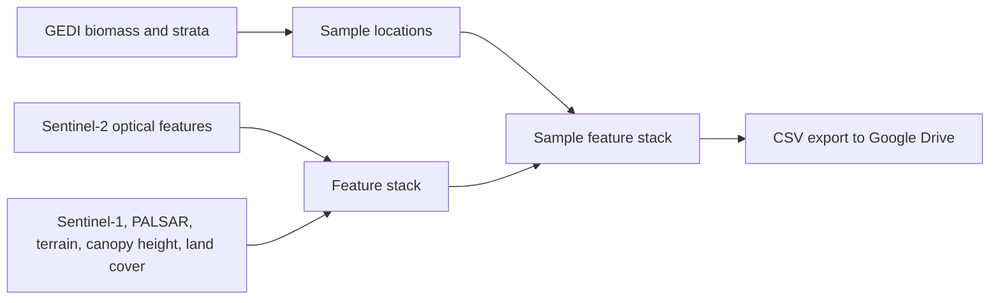
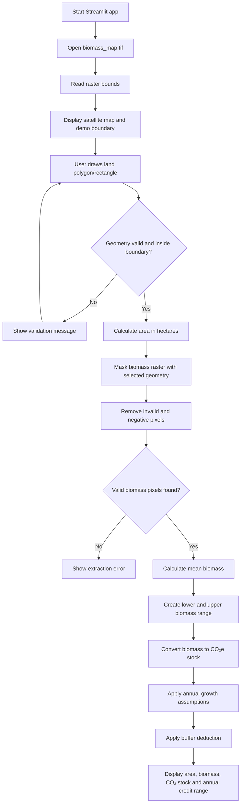

# Carbon Stock & Carbon Credit Estimator

A learning project exploring how satellite remote-sensing data, machine learning, geospatial analysis, and a simple interactive web application can be combined to estimate biomass and translate that estimate into a **rough annual carbon-credit range**.

> **Project goal:** Build a decision-support prototype for farmers and landowners. By outlining a plot of land, a user can get an indicative estimate of its biomass, carbon-dioxide-equivalent stock, and a possible range of annual carbon credits. This can help them understand the potential carbon value of their land and decide whether further assessment or participation in a carbon-credit programme may be worth exploring.
>
> **Important:** This is an educational prototype, not a carbon-credit certification, registry, or financial guarantee. The current app uses assumptions for annual growth and a safety buffer. Actual credits depend on the applicable methodology, baseline, additionality, land eligibility, monitoring, permanence, leakage, verification, and programme rules.

---

## Contents

- [Project Overview](#project-overview)
- [What the Prototype Does](#what-the-prototype-does)
- [Repository Structure](#repository-structure)
- [System Architecture](#system-architecture)
- [Workflow](#workflow)
  - [1. Remote-Sensing Data and Feature Engineering](#1-remote-sensing-data-and-feature-engineering)
  - [2. Biomass Model Development](#2-biomass-model-development)
  - [3. Interactive Land Selection](#3-interactive-land-selection)
  - [4. Biomass and Carbon Calculation](#4-biomass-and-carbon-calculation)
- [Model Development Details](#model-development-details)
- [Calculation Method](#calculation-method)
- [Technology Stack](#technology-stack)
- [Setup and Running the Application](#setup-and-running-the-application)
- [Inputs and Outputs](#inputs-and-outputs)
- [Current Limitations and Future Improvements](#current-limitations-and-future-improvements)
- [Learning Outcomes](#learning-project)

---

## Project Overview

Estimating the carbon stored in a parcel of land is not straightforward. Biomass is influenced by vegetation type, canopy structure, terrain, soil and environmental conditions. Field measurements can be expensive and difficult to scale across large areas.

This project investigates a remote-sensing and machine-learning approach:

1. Use satellite and geospatial datasets to assemble features describing vegetation, radar response, terrain, canopy height, and land cover.
2. Use GEDI biomass observations as the target variable for a supervised regression model.
3. Train and evaluate an XGBoost model to estimate above-ground biomass density (AGBD).
4. Convert biomass estimates into carbon dioxide equivalent (CO₂e).
5. Provide a map-based interface where a user can select a land parcel and receive an indicative result.

The broader motivation is to make carbon estimation more understandable and accessible to **farmers and landowners**, so that they can explore the potential carbon-credit value of their land and use the output as an initial decision-support input.

---

## What the Prototype Does

The project currently contains two connected but separate parts:

### A. Biomass model development notebook

`Carbon_Stock.ipynb` documents the data preparation, feature engineering, exploratory analysis, model training, tuning, and evaluation process for a biomass regression model.

### B. Interactive Streamlit application

`app.py` lets the user draw a polygon or rectangle on a satellite map, extracts biomass values from a GeoTIFF raster for the selected area, calculates the area, and estimates a range of carbon stock and annual credits.

**Current integration status:** the Streamlit app reads `biomass_map.tif` directly and calculates the mean biomass from its pixels. It does **not currently load `biomass_model.joblib` or `feature_columns.json` to predict biomass on demand**. The model-development pipeline and map-based estimator are therefore parts of the same project, but the trained model is not yet wired into the app's prediction path.

---

## Repository Structure

The following structure is based on the project folder shown in the repository screenshot. Some filenames may be shortened by Windows Explorer in the screenshot.

```text
Carbon-Stock-Project/
│
├── .venv/                              # Local Python virtual environment
├── src/                                 # Source code directory (contents not shown)
│
├── app.py                               # Streamlit map-based estimator
├── Carbon_Stock.ipynb                  # Data preparation, EDA, model training and evaluation
│
├── Biomass_Enhanced_Features_2022_2023...csv
│                                        # Exported feature dataset used for model training
├── biomass_map.tif                     # Biomass raster consumed by the current Streamlit app
├── demo_features.tif                    # Large geospatial feature raster / intermediate data
├── export_features.py                   # Feature export-related script
├── make_biomass_map.py                 # Biomass map generation script
├── nit_features.tif                     # Feature raster (filename as shown in the folder)
├── biomass_model.joblib                 # Saved trained model artifact
├── feature_columns.json                 # Feature names/order associated with the model
│
├── Carbon_Stock_Project_Context.md      # Project notes/context
├── pyproject.toml                       # Project/package configuration
├── requirements.txt                     # Python dependencies
├── uv.lock                              # Locked dependency versions for uv
├── .gitignore                           # Git ignore rules
└── README.md                             # Project documentation
```

### Key files

| File | Purpose |
|---|---|
| `Carbon_Stock.ipynb` | Remote-sensing data processing, dataset analysis, preprocessing, XGBoost training, evaluation, and model saving. |
| `app.py` | Streamlit interface for selecting land and estimating area, biomass, CO₂ stock, and annual-credit range. |
| `biomass_map.tif` | Raster biomass layer that the current app samples over the selected polygon. |
| `Biomass_Enhanced_Features_2022_2023...csv` | Tabular dataset containing the target biomass and extracted predictor features. |
| `biomass_model.joblib` | Serialized trained model generated by the notebook. |
| `feature_columns.json` | Feature-column list saved alongside the trained model. |
| `make_biomass_map.py` | Intended/available script for creating the biomass raster. |
| `export_features.py` | Feature-export helper script. |
| `demo_features.tif`, `nit_features.tif` | Geospatial feature/intermediate raster assets. |
| `requirements.txt`, `pyproject.toml`, `uv.lock` | Dependency and environment configuration. |
| `Carbon_Stock_Project_Context.md` | Additional project context and notes. |

> Large datasets and raster files can make a repository heavy. Consider Git LFS, external storage, or documented download instructions before committing large data assets.

---

## System Architecture

### High-level architecture



The dotted connection is a planned integration point: the current app uses the biomass raster rather than the saved XGBoost model.

### Components

- **Data acquisition and preprocessing:** Google Earth Engine is used in the notebook to combine remote-sensing datasets and sample them at GEDI observations.
- **Feature engineering:** Optical vegetation indices, radar features, radar texture, terrain, canopy height, land cover, and location features are assembled.
- **Model development:** A supervised XGBoost regressor is trained to estimate above-ground biomass density.
- **Raster preparation:** A biomass GeoTIFF provides spatial biomass values to the current web app.
- **Application layer:** Streamlit provides the UI, while Folium provides the satellite map and drawing tools.
- **Geospatial processing:** Rasterio reads and masks raster pixels, Shapely validates geometry, and PyProj calculates area.
- **Decision-support output:** Biomass and area are converted to CO₂e stock, then an assumed annual growth percentage and buffer deduction produce a range.

---

## Workflow

### 1. Remote-Sensing Data and Feature Engineering

The notebook uses Google Earth Engine to construct a feature dataset for a study area defined by a bounding box:

```text
Longitude: 75° to 85°
Latitude:  18° to 28°
Period:    2022–2023
```

The data sources used in the notebook include:

#### GEDI biomass observations

The notebook uses the `LARSE/GEDI/GEDI04_A_002_MONTHLY` collection and selects the `agbd` band.

Quality filtering is applied using:

- `l4_quality_flag == 1`
- `degrade_flag == 0`
- `sensitivity >= 0.95`

The filtered observations are composited using a median and clipped to the study area.

The biomass target is divided into strata:

- 0–50 Mg/ha
- 50–100 Mg/ha
- 100–200 Mg/ha
- 200–400 Mg/ha
- Above 400 Mg/ha

A stratified sample is then created with a target of 6,000 points at 50 m scale.

#### Sentinel-2 optical imagery

The notebook uses the `COPERNICUS/S2_SR_HARMONIZED` collection over the study area and 2022–2023 period.

Cloud and cirrus masking is performed using the QA60 band. The median image is used to reduce temporal variability.

Selected spectral bands include:

- B2 — Blue
- B3 — Green
- B4 — Red
- B8 — Near Infrared
- B11 — Short-wave Infrared
- B12 — Short-wave Infrared

The notebook also calculates vegetation indices:

| Index | General purpose |
|---|---|
| NDVI | Vegetation greenness and activity |
| EVI | Vegetation response with improved sensitivity in some high-biomass conditions |
| SAVI | Soil-adjusted vegetation index |
| MSAVI | Modified soil-adjusted vegetation index, useful where soil background influences vegetation signals |

These features are intended to provide information about vegetation condition and canopy characteristics.

#### Sentinel-1 radar

The notebook uses `COPERNICUS/S1_GRD`, filtering for:

- VV and VH polarizations
- IW instrument mode
- 2022–2023
- The study area

A median radar image is produced. The workflow derives:

- VV and VH backscatter
- VV/VH ratio
- VV–VH difference
- GLCM texture features such as contrast, variance, and entropy

Radar can complement optical imagery because it provides structural information and is less dependent on sunlight or cloud-free conditions.

#### ALOS PALSAR-2

The notebook uses the JAXA ALOS PALSAR yearly SAR epoch collection and selects HH and HV bands.

The code converts the digital-number values into a gamma-naught-like dB representation using the implemented conversion:

```text
gamma0(dB) = 10 × log10(DN²) − 83
```

The resulting features are named `PALSAR_HH` and `PALSAR_HV`.

#### Terrain

Terrain features are derived from the SRTM elevation dataset:

- Elevation
- Slope
- Aspect

Terrain may help explain differences in vegetation distribution and environmental conditions.

#### Canopy height

The notebook uses the ETH Global Canopy Height 2020 10 m dataset and adds a `canopy_height` feature.

#### Land cover

ESA WorldCover is used as a land-cover feature. The categorical land-cover variable is later one-hot encoded during model preparation.

#### Location

Latitude and longitude are included in the extracted feature dataset. They are later removed from the model's feature matrix in the notebook's feature-selection step.

---

### 2. Feature Sampling and Dataset Export

The raster feature stack is assembled from the processed imagery and derived datasets.

The notebook samples the stacked features at the stratified GEDI sample locations, retaining the target biomass (`agbd`) and biomass class (`agb_class`).

The resulting table is exported to Google Drive as a CSV file. That exported CSV is then imported into the notebook for the model-training stage.



---

### 3. Biomass Model Development

The exported dataset is loaded into Pandas for cleaning and model development.

#### Data preparation

The notebook:

1. Removes extraction-only columns such as `system:index` and `.geo`.
2. Checks land-cover class distribution and biomass strata.
3. Checks missing values.
4. Separates the target (`agbd`) from predictor features.
5. Keeps `agb_class` for stratified splitting/cross-validation rather than using it as a model predictor.
6. One-hot encodes the `LandCover` categorical feature.
7. Splits data into training and testing sets using an 80/20 split and `random_state=42`.

#### Exploratory data analysis

The notebook explores:

- Biomass target distribution
- Predictor correlation matrix
- Relationships between biomass and selected features
- Canopy height vs. biomass
- MSAVI vs. biomass
- Radar texture vs. biomass
- NDVI vs. biomass

This is used to understand the data, potential relationships, and possible multicollinearity.

#### Feature reduction

The notebook removes selected features to reduce multicollinearity and simplify the feature set. The columns dropped in the notebook include:

```text
B2, B3, B11, NDVI, SAVI, VV, VV_contrast, VH_var,
latitude, longitude
```

The exact final feature set is determined by the remaining columns after preprocessing.

#### Outlier/anomaly filtering

The notebook applies these conditions to training and test data:

- Biomass target is no greater than 400 Mg/ha.
- Records with canopy height equal to zero and biomass above 50 Mg/ha are removed.

The notebook then applies `log1p` to the training target to reduce skewness.

#### Model choice: XGBoost Regressor

XGBoost is selected as a tree-based regression model. It can learn non-linear relationships and interactions between remote-sensing features and biomass without requiring all relationships to be linear.

The notebook uses a randomized hyperparameter search over parameters such as:

- `n_estimators`
- `learning_rate`
- `max_depth`
- `subsample`
- `colsample_bytree`
- `colsample_bylevel`

The search uses 75 randomly selected combinations in the code and five-fold stratified cross-validation based on biomass classes. The scoring objective is negative mean squared error.

#### Evaluation

Predictions are transformed back from log space using `expm1` and evaluated against the original biomass values.

The notebook calculates:

- R²
- Mean Squared Error (MSE)
- Root Mean Squared Error (RMSE)
- Mean Absolute Error (MAE)

It also visualizes:

- Actual vs. predicted biomass
- Residuals vs. canopy height
- Residuals vs. actual biomass
- Absolute error by biomass range

These diagnostics help identify where the model performs well and where errors are concentrated.

#### Model artifacts

At the end of the notebook, the best estimator is saved using Joblib:

```text
biomass_model.joblib
```

The model's feature names/order are saved to:

```text
feature_columns.json
```

These artifacts are intended to make the trained model reusable without repeating the full training process.

---

### 4. Interactive Land Selection

The current application is built using Streamlit and Folium.

#### Map initialization

The app opens `biomass_map.tif` and reads its geographic bounds. Those bounds define the demo region.

The map uses Esri World Imagery satellite tiles and displays a blue rectangle representing the region covered by the biomass raster.

#### Land drawing

The user can draw either:

- A polygon
- A rectangle

The drawing tools allow editing and deleting the selected geometry. Circles, markers, and lines are disabled.

The user is expected to outline their land parcel within the raster's coverage boundary.

#### Geometry validation

The selected geometry is checked for:

- Valid geometry
- Non-empty geometry
- Complete containment within the demo region

If the geometry is invalid or outside the supported region, the application displays an error and stops processing.

#### Area calculation

The area is calculated geodesically using the WGS84 ellipsoid through PyProj's `Geod.geometry_area_perimeter`.

The area in square metres is converted into hectares:

```text
Area (ha) = Area (m²) / 10,000
```

---

### 5. Biomass Extraction from the Raster

The app uses Rasterio to mask `biomass_map.tif` using the user's drawn geometry.

The raster pixels intersecting the selected parcel are extracted. Invalid values and negative biomass values are removed.

The mean of the remaining pixels is used as the estimated above-ground biomass density:

```text
Mean AGB = Mean of valid biomass pixels inside the selected geometry
```

The current app uses a fixed model-error allowance of `41 Mg/ha`:

```text
Lower AGB = max(Mean AGB − 41, 0)
Upper AGB = Mean AGB + 41
```

This produces a lower and upper biomass estimate. The value 41 is a fixed assumption in the current code, not a dynamically calculated confidence interval.

---

### 6. Carbon and Annual-Credit Calculation

The app converts biomass into CO₂-equivalent stock using configurable assumptions.

#### Root-to-shoot ratio

The user can adjust the root-to-shoot ratio in the sidebar. The default is 0.24.

This estimates below-ground biomass relative to above-ground biomass:

```text
Total biomass = Above-ground biomass × (1 + Root-to-shoot ratio)
```

#### Biomass to carbon

The app uses a carbon fraction of 0.47:

```text
Carbon stock = Total biomass × 0.47
```

#### Carbon to CO₂ equivalent

The molecular-weight conversion factor is 44/12:

```text
CO₂e = Carbon stock × (44 / 12)
```

The calculation is performed per hectare and then multiplied by the selected parcel's area.

#### Annual growth assumption

The sidebar lets the user choose a low and high annual carbon gain percentage. The default range is 2% to 5%.

The app applies these percentages to the estimated CO₂ stock to produce an annual range.

#### Buffer deduction

A buffer/safety deduction can be selected, with a default of 15%.

The remaining fraction is:

```text
Keep fraction = 1 − (Buffer percentage / 100)
```

#### Final estimate

```text
Annual credits (low)
    = Lower CO₂ stock × Lower annual growth rate × Keep fraction

Annual credits (high)
    = Upper CO₂ stock × Upper annual growth rate × Keep fraction
```

The application displays the result as a range in tonnes of CO₂ equivalent per year. The app assumes that one carbon credit corresponds to one tonne of CO₂e for presentation purposes.

---

## End-to-End Application Flow



---

## Calculation Reference

Let:

- \(A\) = parcel area in hectares
- \(AGB\) = mean above-ground biomass density in Mg/ha
- \(R\) = root-to-shoot ratio
- \(f_C\) = carbon fraction, currently 0.47
- \(G_L\), \(G_H\) = low and high annual growth assumptions
- \(B\) = buffer percentage
- \(E\) = fixed biomass error allowance, currently 41 Mg/ha

### Biomass uncertainty range

```text
AGB_low  = max(AGB − E, 0)
AGB_high = AGB + E
```

### CO₂e stock per hectare

```text
CO₂e/ha = AGB × (1 + R) × fC × (44/12)
```

### Total CO₂e stock for the parcel

```text
Stock_low  = CO₂e/ha using AGB_low  × A
Stock_high = CO₂e/ha using AGB_high × A
```

### Annual credit estimate

```text
Annual_low  = Stock_low  × (GL / 100) × (1 − B/100)
Annual_high = Stock_high × (GH / 100) × (1 − B/100)
```

These formulas are estimates for the prototype. The app does not currently perform a full carbon-project accounting methodology.

---

## Technology Stack

| Technology | Role |
|---|---|
| Python | Main programming language |
| Google Earth Engine | Remote-sensing data access and processing |
| GEDI | Biomass observations used as model target |
| Sentinel-2 | Optical imagery and vegetation indices |
| Sentinel-1 | C-band radar and texture features |
| ALOS PALSAR-2 | L-band radar features |
| SRTM | Elevation and terrain derivatives |
| ESA WorldCover | Land-cover feature |
| ETH Global Canopy Height | Canopy-height feature |
| Pandas / NumPy | Data manipulation |
| XGBoost | Biomass regression model |
| Scikit-learn | Data splitting, cross-validation, hyperparameter search and metrics |
| Joblib | Model serialization |
| Rasterio | GeoTIFF reading and raster masking |
| Shapely | Geometry parsing and validation |
| PyProj | Geodesic area calculation |
| Folium | Interactive map |
| Streamlit | Web application UI |
| streamlit-folium | Folium map integration |
| Matplotlib / Seaborn | Model diagnostics and exploratory plots |

---

## Setup and Running the Application

### Prerequisites

- Python installed
- A local copy of the repository
- The required biomass raster (`biomass_map.tif`)
- Dependencies listed in `requirements.txt`
- Google Earth Engine access/authentication if you want to rerun the notebook's data-processing stage

### 1. Clone the repository

```bash
git clone <your-repository-url>
cd <repository-folder>
```

### 2. Create and activate a virtual environment

Windows PowerShell:

```powershell
python -m venv .venv
.venv\Scripts\Activate.ps1
```

Windows Command Prompt:

```cmd
python -m venv .venv
.venv\Scripts\activate
```

Linux/macOS:

```bash
python -m venv .venv
source .venv/bin/activate
```

### 3. Install dependencies

```bash
pip install -r requirements.txt
```

If the project uses `uv`:

```bash
uv sync
```

### 4. Run the Streamlit app

Make sure `biomass_map.tif` is located in the same directory as `app.py`, unless the path in the code is changed.

```bash
streamlit run app.py
```

The app will open in your browser. Draw a polygon or rectangle within the blue demo boundary and review the estimate.

### 5. Reproduce model development

Open:

```text
Carbon_Stock.ipynb
```

The notebook includes the Earth Engine authentication and processing steps, dataset loading, preprocessing, training, evaluation, and model saving.

The Earth Engine export stage requires an authenticated Google Earth Engine account and access to the configured project. The notebook's exported CSV is also required for the model-training cells.

---

## Inputs and Outputs

### User inputs in the Streamlit app

| Input | Default | Purpose |
|---|---:|---|
| Drawn land geometry | User-selected | Defines the parcel to analyze |
| Root-to-shoot ratio | 0.24 | Adds estimated below-ground biomass |
| Annual carbon gain | 2%–5% | Defines the annual growth range |
| Buffer deduction | 15% | Reduces the estimate for a safety allowance |

### Application outputs

- Selected parcel area in hectares
- Mean estimated biomass in Mg/ha
- Lower and upper CO₂e stock estimates in tonnes
- Indicative annual carbon-credit range

---

## Current Limitations

This is an experimental learning project. The following limitations are important:

1. **The app uses a pre-generated biomass raster.** It does not currently run the saved XGBoost model on the selected polygon's satellite features.
2. **The error range is fixed.** The app subtracts/adds 41 Mg/ha rather than deriving a spatially or statistically calibrated uncertainty interval.
3. **Annual growth rates are assumptions.** The default 2%–5% range is configurable but is not automatically derived from a forest-growth model or carbon methodology.
4. **The carbon fraction is fixed at 0.47.** Actual biomass-to-carbon factors can depend on vegetation type and methodology.
5. **The root-to-shoot ratio is an assumption.** It may vary by ecosystem and species.
6. **The buffer is not a formal risk assessment.** A user-selected deduction is not equivalent to a methodology-approved buffer pool.
7. **The app is geographically constrained.** It only supports parcels fully inside the bounds of the provided biomass raster.
8. **No baseline or additionality analysis is performed.** The app does not determine whether carbon sequestration is additional to what would have happened otherwise.
9. **No permanence, leakage, monitoring, or verification workflow exists.**
10. **The estimate is not a market or revenue estimate.** It does not apply carbon-credit prices, transaction costs, project fees, or eligibility rules.
11. **The model's validity depends on its training data.** GEDI samples, the selected study region, temporal coverage, preprocessing choices, and model errors may limit generalization.

The displayed annual credit range should therefore be interpreted as an exploratory estimate of potential—not a quantity of credits that can currently be issued or sold.

---

## Future Improvements

Potential next steps for the project:

- Integrate `biomass_model.joblib` into the Streamlit app so predictions can be generated from extracted raster features.
- Build a complete feature raster stack with the exact feature names and order stored in `feature_columns.json`.
- Add support for more regions and dynamically load appropriate raster/model assets.
- Use model-based uncertainty estimation or calibrated prediction intervals instead of a fixed ±41 Mg/ha allowance.
- Add land-cover-specific biomass and root-to-shoot assumptions.
- Improve temporal analysis to estimate biomass change between years.
- Add a more defensible baseline and annual sequestration calculation.
- Add methodology-specific eligibility checks and clearly explain the requirements to the user.
- Include soil carbon only if reliable data and a suitable methodology are available.
- Add downloadable reports containing the selected geometry, inputs, calculations, assumptions, and limitations.
- Improve validation with independent field data.
- Add unit tests for area calculation, raster masking, geometry validation, and carbon-conversion functions.
- Add caching and optimize raster processing for larger datasets.
- Add user-friendly guidance for farmers and landowners, including plain-language interpretation of the estimate.

---

## Learning Project

This repository is primarily a **learning and experimentation project** focused on combining:

- Remote sensing
- Geospatial data processing
- Machine learning
- Biomass estimation
- Carbon accounting concepts
- Interactive web development
- Decision-support system design

The objective is not to claim that the application can certify carbon credits. Instead, it demonstrates how publicly available Earth-observation data and a machine-learning workflow could form the foundation of a tool that helps farmers and landowners **explore the carbon potential of their land and make more informed decisions about whether to investigate carbon-credit opportunities**.

The project can be developed further into a more robust decision-support system with validated models, methodology-specific calculations, and field verification.

---

## Disclaimer

The outputs are **indicative estimates for educational and exploratory use only**. They are not verified carbon credits, an official carbon inventory, a certification, or financial advice. Before making land-management, carbon-project, or commercial decisions, users should consult relevant carbon standards, qualified project developers, and independent verification professionals.
